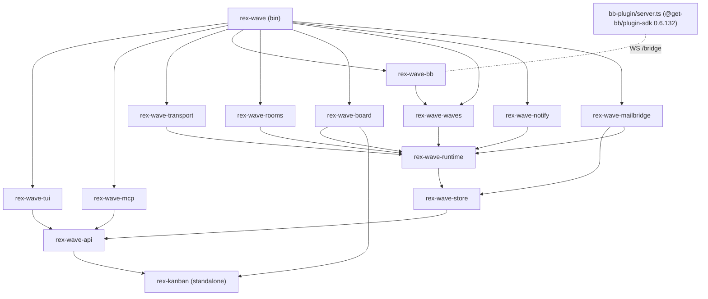

# rex-wave architecture

> **Thesis.** Every piece of rex-wave belongs to one of three layers:
> 1. **The contract** (`rex-wave-api` and `rex-kanban`). One `commands!` list generates the wire enums, the router enum, the typed `Command` impls, and the JSON-schema `TOOLS` catalog for MCP and BB. Every caller speaks one `Client` trait with two required methods, `call_wire` and `watch`.
> 2. **Deciders**. One pure `decide / evolve / reply` type per subsystem. `rex-wave-runtime` runs each decider as one single-writer actor per stream (one per room, wave, board, or inbox).
> 3. **Reactors**. Process managers that perform side effects (BB thread spawns, doorbells, notifications, wake-bell delivery). Each reactor watches frames and sends commands through the same `Client` trait that every UI uses.
>
> The TUI, CLI, MCP atomic tools, MCP `run_code`, the BB plugin bridge, a future desktop GUI, and the daemon's own reactors all take that single path into the daemon.

## Problem

We need Slack-style `#channels`, direct messages between people and agents, multi-provider BB waves that create `#wave-<slug>` under a BB project, a standalone-liftable Kanban and org-todo board, and ranked rich notifications. Everything runs as a Rust daemon with a two-pane ratatui client inside Rex.

Several constraints fix the design:

- **Many clients, one behavior.** TUI, CLI, MCP stdio and HTTP (both atomic tools and `run_code`), BB agent tools, and a future GUI must agree on every command and permission check. Any per-client logic drifts.
- **Kanban must lift out cleanly.** `rex-kanban` owns the board model, `CardRevision` compare-and-swap, and `.org` codec with zero dependency on rooms, waves, BB, mail, or `rex-wave-api`.
- **BB owns threads.** BB owns provider runtimes, worktrees, logins, and thread event logs. rex-wave proxies BB thread events and never copies them into its journal. Workers sit in four distinct non-working states (`Parked` inside `wait`, `Idle` after a turn ends, `Blocked` on an interaction, `Errored`), and each state takes a different wake path.
- **House mail laws hold.** Rooms are weather and letters are canon. `promote_to_letter` writes and syncs the letter file before appending `Banked` to the journal (law I2), never deletes existing files, and acknowledges only exact `Sha256Hex` bytes. All mail I/O runs inside a verified non-production `SandboxRoot`.
- **Identity never comes from arguments.** The transport binds `Principal` once during `Hello`, or the BB bridge resolves it from the thread's recorded `pluginMetadata`. No command struct has a `from` field.
- **Measured runtime budgets apply.** A fresh `rquickjs` `AsyncRuntime` per `run_code` call takes 0.55 ms at p50. BB's worktree provider id is `"git-worktree"`. Kitty `z=-1` cards need `Color::Reset` cell interiors, DECSET 2026 synchronized frames, and viewport clip math.
- **Two-pane TUI layout.** The left pane is a foldable org-tree (`Inbox`, `Kanban`, divider, `Projects` unfolding to `#channels` and `#wave-<slug>` rooms with child wave agents, `Channels`, `Direct Messages`). The right pane is a single context-sensitive stage driven by tree selection or hover, stamped with a server-assigned `FocusGeneration` so rapid navigation never renders a stale frame.

## Usage from the caller's view

### CLI (`rex-wave`)

Every CLI verb parses into one `WireCommand` and calls `Client::call_wire`:

```sh
rex-wave daemon --mail-sandbox /tmp/rex-mail-sandbox
rex-wave tui

rex-wave wave start auth-v2 --project p_123 --goal-file goal.md \
	--worker author-jwt=codex/gpt-6.1-sol --worker verifier=claude-code/claude-opus-5-5 \
	--worker migrator=pi/openrouter/~anthropic/claude-sonnet-latest

rex-wave post '#p_123/wave-auth-v2' '@verifier check #4'
rex-wave post @sol 'can you take the migration?'
rex-wave wait '#p_123/wave-auth-v2' --since 41
rex-wave wave approve auth-v2 migrator int_8f2
rex-wave task add 'Wire OAuth refresh' --board project:p_123 --lane todo --assign @auth-v2/author-jwt
rex-wave promote '#p_123/wave-auth-v2' 40..44 --to owner --subject 'auth-v2 ruling' --topic auth-v2-ruling
rex-wave call room_post '{"room":{"ref":"dm","with":{"kind":"seat","seat":"astra"}},"body":"lgtm"}'
rex-wave schema --bb > bb-plugin/tools.generated.json
```

### MCP atomic tools

A seat connects with a capability token, so the daemon binds `Principal::Seat` at session open:

```sh
REX_WAVE_TOKEN=$(rex-wave token --seat sol) rex-wave mcp --stdio
```

```json
{"method":"tools/call","params":{"name":"room_post","arguments":{
	"room":{"ref":"channel","scope":{"scope":"project","project":"p_123"},"name":"wave-auth-v2"},
	"body":"@verifier slice A ready (#4)"}}}
```

### MCP Code Mode (`run_code`)

Each `run_code` call creates a fresh QuickJS runtime with memory, stack, and deadline caps, exposing a frozen `rex` object built from `TOOLS`:

```js
const board = "project:p_123";
const snap = await rex.board_view({ board });
const mine = snap.lanes
	.flatMap(l => l.cards)
	.filter(c => c.assignee === "@auth-v2/author-jwt");
for (const c of mine) {
	await rex.card_upsert({
		board,
		card: c.no,
		expected: c.revision,
		patch: { lane: "review" }
	});
}
await rex.room_post({
	room: { ref: "channel", scope: { scope: "project", project: "p_123" }, name: "wave-auth-v2" },
	body: `@verifier ${mine.length} cards moved to review`
});
return mine.map(c => c.no);
```

### Rust client and two-pane stage switching

TUI, GUI, and reactors drive `Client` identically:

```rust
use rex_wave_api::{Client, Cursor, Frame, Interest, stage::StageTarget, room::*, read::*};
use rex_wave_transport::{Credential, Endpoint, RemoteClient};

let client = RemoteClient::connect(Endpoint::default_unix(), Credential::PeerUid, "tui").await?;

// Watch the left-pane tree; bursts coalesce into SidebarTreeSnapshot frames.
let mut sidebar = client.watch(Interest::Sidebar, Cursor::live()).await?;

// Send a typed command over the same socket.
let posted = client.call(RoomPost {
	room: RoomRef::Dm { with: sol },
	body: Body::parse("ping")?,
	reply_to: None,
	idem: None,
}).await?;

// Hovering an agent retargets the session's single stage slot, ending the old
// stage watch on the server and stamping every frame with FocusGeneration.
let page = client.call(ThreadPage { wave: w.clone(), role: r.clone(), after: None, limit: Some(200) }).await?;
let mut stage = client.watch(
	Interest::Stage { target: StageTarget::Agent { wave: w, role: r } },
	Cursor::live(),
).await?;
```

## Shape

### Crate map (14 crates, arrows point to dependencies)



No subsystem crate imports a sibling subsystem crate. Only `rex-wave-bb` imports `rex-wave-waves`, because `rex-wave-bb` implements the `AgentHost` port defined there. Five workers can implement `rooms`, `kanban+board`, `waves+bb+plugin`, `notify+mailbridge`, and `mcp+tui+cli` in separate git worktrees without touching shared foundation files.

### Core data shapes

- **Branded identifiers** (`SeatName`, `RoleName`, `WaveSlug`, `ChannelName`, `Handle`, `BbThreadId`, `ProviderId`, `Sha256Hex`, `BoardId`, `LaneName`, `Title`) validate once at `serde(try_from)` boundaries and carry `JsonSchema` impls for catalog generation. `Seq` (journal) and `BbSeq` (BB thread) stay distinct types.
- **`Principal`** (`Operator`, `Seat`, `Worker { wave, role }`, `System { part }`) is bound once per session by `rex-wave-transport` or `rex-wave-bb`. `Router::dispatch` runs `authorize(audience, by)` before routing.
- **`StreamId`** (`Room`, `Wave`, `Board`, `Inbox`, `Mail`) names both one journal log and one single-writer actor. `RoomId` uses natural keys (`Channel { scope, name }` or normalized `Direct { pair }`), making `room_ensure` idempotent and guaranteeing one DM per pair.
- **`Journal` and `StreamWriter`** (`rex-wave-store`) persist an append-only SQLite WAL table keyed by `(stream, seq)` with `UNIQUE(stream, idem)`. `Journal::claim` returns an unclonable `StreamWriter` and rejects a second live writer for the same stream. Multi-event batches record their length on the batch's first row so an idempotent retry replays the entire original batch.
- **Actor-owned runtime state** (`rex-wave-runtime`) avoids shared-map mutexes. `Registry<D>` runs an owner task that spawns per-stream `StreamActor<D>` tasks on demand, rehydrates them from `Journal`, and passivates them after an idle timeout. `SidebarProjection` folds the live `Hub` into immutable `Arc<World>` snapshots published over a `tokio::sync::watch` channel.
- **`ReadSide::watch`** enforces the anti-sleep-through rule: tap `Hub` first, snapshot and replay `Journal` second, and deduplicate live envelopes by `(stream, seq)`. `Wait` builds directly on `watch_journal`, returning the full catch-up slice or the first live batch after `CaughtUp`.
- **`Session` stage focus** holds a `watch::Sender<FocusGeneration>`. Opening `Interest::Stage { target }` increments the generation, ends any prior stage watch on that session (dropping any leased `AgentFeed` stream), emits `Frame::StageFocused`, and wraps subsequent frames in `Frame::Stage { generation, inner }`.

## Synthesis decision

In the blinded three-way architecture bakeoff (`#29`), `arch-judge` selected **Candidate 1 (`arch-opus`)** as the base with **27/30**, ahead of **Candidate 2 (`arch-carbon`, 24/30)** and **Candidate 3 (`arch-hydrogen`, 17/30)**.

| Criterion | C1 | C2 | C3 |
|---|---|---|---|
| 1. Interface depth and boundary | 5 | 3 | 2 |
| 2. Actor ownership and no locks | 5 | 4 | 3 |
| 3. Domain types | 4 | 5 | 3 |
| 4. Platform seams | 4 | 4 | 3 |
| 5. Two-pane tree and inspector | 4 | 5 | 4 |
| 6. Parallel decomposability | 5 | 3 | 2 |

### Why Candidate 1 won

- **One deep contract.** `Client { call_wire, watch }` and one `commands!` macro invocation generate `WireCommand`, `WireReply`, `Family`, `Routed`, typed `Command` impls, `TOOLS`, and `bb-plugin/tools.generated.json`. There is no second hand-kept list to drift. Both `rex-wave-bb::protocol` and `rex-wave-transport::wire` stay private.
- **Single writer by construction.** `Journal::claim` hands out an unclonable `StreamWriter`. Subsystems write pure `Decider`s, and side effects live in level-triggered `Reactor`s.
- **Clean parallel worktree split.** Every domain subsystem lives in its own crate with zero sibling coupling.

### Grafts folded into the foundation

1. **Server-aware `FocusGeneration` and `SidebarTreeSnapshot` (from Candidate 2).** Added `FocusGeneration`, `StageTarget`, `Interest::Stage`, `Interest::Sidebar`, `Frame::StageFocused`, `Frame::Stage`, and `Frame::Sidebar` directly onto C1's `watch` path rather than introducing a second RPC trait. Replaced `OverviewSnapshot` with C2's two-pane `SidebarTreeSnapshot` (`InboxBadge`, `BoardBadge`, foldable `ProjectBranch` with `ChannelLeaf` and `WaveRoomBranch` containing `WaveWorkerLeaf` children, global `ChannelLeaf`, `DmLeaf`, and `Osc7501Status`).
2. **Full BB SDK 0.6.132 interaction resolutions, steer modes, wakeup planner, and OSC 7501 derivation (from Candidate 2).** Replaced C1's partial `Resolution` and 3-variant `TellMode` with full `InteractionResolution` (`AllowOnce` and `AllowForSession` with `GrantedPermissions`, `Deny`, `UserAnswer`, `PluginSubmitted`, and `RequestAnswer`) and all five `SteerDeliveryMode` variants (`auto`, `start`, `steer`, `steer-if-active`, `queue-if-active`). Added `Activity::Parked { room, since }`, pure `plan_mention_wakeup`, and pure `derive_osc7501_status`.
3. **Rich `ThreadContextUsage` for the Context Window Inspector (from Candidate 3).** Replaced C1's two-field `ContextUsage` with `ThreadContextUsage` (`used_tokens`, `model_context_window`, `estimated`, `auto_compact_at_tokens`, `cost_usd`, and `ContextCategory` slices) and wired `bb.sdk.threads.context` in `bb-plugin/server.ts`.
4. **Zero-dependency `rex-kanban` crate and lock-free runtime actors (from Candidate 3 and Candidate 2).** Extracted `rex-kanban` with zero rex-wave dependencies, owning `BoardState`, `CardRevision` compare-and-swap, opaque `ExternalLink`, and `org` codec stubs, re-exported through `rex-wave-api::board` and `commands!`. Replaced C1's `Mutex<HashMap>` in `Registry` and `Mutex` in `OverviewProjection` with an actor-owned `RegistryTask` and a `watch`-published `SidebarProjection`, satisfying every `arch-judge` deduction on C1.

### What was rejected from Candidates 2 and 3

- **Hand-maintained tool catalogs.** C2 kept separate `Command`, `MCP_TOOL_CATALOG`, and hand-written Zod `registerTool` lists (omitting interaction resolution, archive, and wake-bell in MCP). C3 mirrored a 14-method `DaemonClient` trait by hand across `ToolRegistry`, wire types, and Zod schemas. Both were rejected in favor of `commands!` plus `schemars` generation.
- **Public bridge wire types.** C2 publicly re-exported `BbBridgeInbound` and `BbBridgeOutbound` from `rex-protocol`, leaking plugin bridge framing to UI crates.
- **Monolithic `rex-daemon` crate.** Both C2 and C3 placed all actors inside a single daemon crate, which would force parallel workers to edit the same files.
- **Forgeable caller and shared locks in C3.** C3 exposed a `pub` `AuthenticatedCaller::from_verified_principal` constructor in `rex-core`, used `RwLock` maps in `DaemonHub` and `AuthVerifier`, and called `threads.archive` before `threads.stop` (leaving hidden BB runtimes loaded). All were rejected.

## Tradeoffs and open questions

- **Flat tool names** (`room_post`, `card_upsert`, `wave_start`) trade per-module name nesting for zero-mapping dispatch across CLI, MCP, Code Mode, and BB agent tools.
- **Eventual consistency on external effects.** `wave_start` commits wave intent before BB spawns finish; `WaveConductor` reconciles on startup replay and live frames so BB restarts never block chat or boards.
- **Mail I/O inside `MailBridge`.** `MailBridge` is the one service that writes disk before appending its journal event, because house-mail law I2 forbids announcing a letter before its bytes are banked.
- **Spawn crash window.** `bb-plugin/server.ts` writes the `(waveId, role, attempt) -> threadId` KV entry both after `threads.spawn` and on `thread.created`; `rex-wave-bb` can also scan `experimental_listPluginMetadata` if KV is cold.
- **Remote principal delegation after a Kanban split.** `Remote<C>` currently calls the split-out board daemon under the forwarding daemon's session; carrying `ctx.by` across processes will need a signed delegation envelope when Kanban runs multi-user out of process.
- **BB push plugin RPC.** The bundled `push-notifications` plugin id and `notifications.send` schema in `bb-plugin/server.ts` still need live runtime verification against BB 0.49.

## Gate 1 verification

All four blocking foundation crates (`rex-wave-api`, `rex-wave-store`, `rex-wave-runtime`, `rex-wave-transport`) and `rex-kanban` are implemented and tested offline:

```sh
cargo check --workspace --all-targets --offline
cargo test -p rex-kanban -p rex-wave-api -p rex-wave-store -p rex-wave-runtime -p rex-wave-transport --offline
ELECTRON_RUN_AS_NODE=1 /Applications/bb.app/Contents/MacOS/bb ./bb-plugin/node_modules/typescript/bin/tsc -p ./bb-plugin/tsconfig.json --noEmit
```
